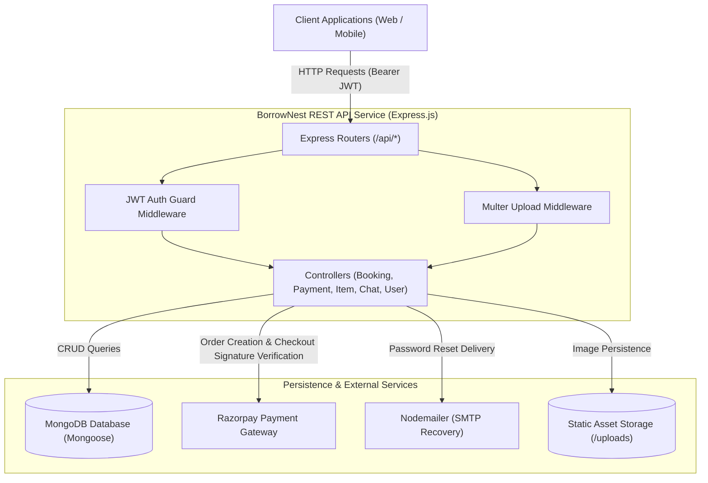

# BorrowNest — Peer-to-Peer Rental & Scheduling REST API Engine

[](https://nodejs.org/)
[](https://expressjs.com/)
[](https://mongoosejs.com/)
[](https://jwt.io/)
[](https://razorpay.com/)

**BorrowNest** is a RESTful backend API engine built with **Node.js**, **Express**, and **MongoDB** designed to power peer-to-peer (P2P) item rental platforms. It handles the end-to-end transactional lifecycle of short-term equipment and asset rentals—including automated booking conflict prevention, dynamic hourly pricing, payment processing with Razorpay, contextual in-app messaging between users, and asset lifecycle management.

> **Architecture Scope**: This repository provides the backend service, business logic, and database schemas. It exposes a stateless, decoupled REST API ready to be consumed by any web or mobile client.

---

## ⚡ Core Engineering Highlights

- **Conflict-Free Booking & Scheduling**: Implements database-level interval overlap validation to prevent double-booking:
  $$\text{Overlap} \iff (\text{Existing.StartTime} < \text{Requested.EndTime}) \land (\text{Existing.EndTime} > \text{Requested.StartTime})$$
  Excludes cancelled reservations and temporary unpaid holds. An item availability endpoint (`GET /api/bookings/item/:itemId`) feeds client calendar slot disabling.
- **Razorpay Checkout Signature Verification**: Generates server-side payment orders and validates payment integrity using cryptographic HMAC-SHA256 signature verification directly against client checkout callback payloads:
  $$\text{Signature} = \text{HMAC-SHA256}(\text{order\_id} + \text{"|"} + \text{payment\_id}, \text{RAZORPAY\_KEY\_SECRET})$$
  Supports both online payments and pay-on-delivery settlement.
- **Stateless JWT Authentication**: Secure authentication with JSON Web Tokens, password salting and hashing via `bcryptjs` (10 rounds), and token-based password recovery via Nodemailer SMTP.
- **Contextual In-App Chat**: Automatically spawns an isolated `Chat` thread linked to every active booking, restricted strictly to the lender and renter.
- **Inventory Management & Soft Deletion**: Multi-category item cataloging (`Electronics`, `Kitchen`, `Home`, `Transport`, `Others`), multipart image uploads via Multer, and non-destructive soft-delete (`isDeleted: true`) preserving historical booking records.

---

## 🏗️ Architecture Overview



---

## 🗄️ Database Schema (Mongoose)

| Collection | Schema Highlights | Relationships | Purpose |
| :--- | :--- | :--- | :--- |
| **`User`** | `name`, `email`, `password`, `location`, `avatar`, `resetPasswordToken` | Referenced by `Item`, `Booking`, `Chat` | User identities and authentication state |
| **`Item`** | `name`, `description`, `pricePerHour`, `category`, `image`, `isDeleted` | `owner` $\rightarrow$ `User` | Rental item catalog and hourly pricing |
| **`Booking`** | `startTime`, `endTime`, `status`, `paymentStatus`, `razorpayOrderId` | `item` $\rightarrow$ `Item`, `renter` $\rightarrow$ `User`, `owner` $\rightarrow$ `User` | Reservations, time intervals & payment state |
| **`Chat`** | `participants`, `messages: [{ sender, text, createdAt }]` | `booking` $\rightarrow$ `Booking`, `participants` $\rightarrow$ `User` | Booking-specific direct communication |

---

## 📡 REST API Reference

### Authentication (`/api/auth`)
| Method | Endpoint | Access | Description |
| :--- | :--- | :---: | :--- |
| `POST` | `/api/auth/register` | Public | Register new user account |
| `POST` | `/api/auth/login` | Public | Authenticate user & return JWT token |
| `POST` | `/api/auth/forgot-password` | Public | Generate reset token and email password reset link |
| `POST` | `/api/auth/reset-password/:token` | Public | Reset password using valid recovery token |

### User Profile (`/api/users`)
| Method | Endpoint | Access | Description |
| :--- | :--- | :---: | :--- |
| `GET` | `/api/users/me` | Private | Retrieve authenticated user profile |
| `PATCH` | `/api/users/me` | Private | Update authenticated user profile |

### Item Catalog (`/api/items`)
| Method | Endpoint | Access | Description |
| :--- | :--- | :---: | :--- |
| `GET` | `/api/items` | Public | List all active (non-deleted) items |
| `GET` | `/api/items/with-availability` | Public | Fetch active items with availability status |
| `GET` | `/api/items/:id` | Public | Retrieve single item details by ID |
| `POST` | `/api/items/add` | Private | Create item listing (supports multipart `image` upload) |
| `GET` | `/api/items/my` | Private | List all items listed by authenticated user |
| `PATCH` | `/api/items/soft-delete/:id` | Private | Soft-delete an item (owner-only) |
| `PATCH` | `/api/items/restore/:id` | Private | Restore a soft-deleted item (owner-only) |

### Bookings & Scheduling (`/api/bookings`)
| Method | Endpoint | Access | Description |
| :--- | :--- | :---: | :--- |
| `POST` | `/api/bookings/create` | Private | Book an item slot with conflict detection |
| `GET` | `/api/bookings/my` | Private | List reservations made by authenticated user |
| `GET` | `/api/bookings/owner` | Private | List incoming bookings on user's items |
| `GET` | `/api/bookings/item/:itemId` | Public | Get booked time intervals for calendar slot disabling |
| `PATCH` | `/api/bookings/cancel/:id` | Private | Cancel an active reservation |
| `PATCH` | `/api/bookings/cancel-pending/:id` | Private | Cancel a reservation with pending payment |

### Payments (`/api/payments`)
| Method | Endpoint | Access | Description |
| :--- | :--- | :---: | :--- |
| `POST` | `/api/payments/create-order` | Private | Generate Razorpay order for an active reservation |
| `POST` | `/api/payments/verify` | Private | Cryptographically verify Razorpay checkout callback signature |
| `POST` | `/api/payments/pay-on-delivery` | Private | Mark booking payment as pay-on-delivery |

### In-App Messaging (`/api/chats`)
| Method | Endpoint | Access | Description |
| :--- | :--- | :---: | :--- |
| `GET` | `/api/chats/my` | Private | List all active chat threads for logged-in user |
| `GET` | `/api/chats/booking/:bookingId` | Private | Retrieve chat thread tied to a specific booking |
| `GET` | `/api/chats/:chatId` | Private | Retrieve full message history of a chat |
| `POST` | `/api/chats/:chatId/message` | Private | Send a new message to the conversation |

### System Diagnostics
| Method | Endpoint | Access | Description |
| :--- | :--- | :---: | :--- |
| `GET` | `/` | Public | Service health probe (`"BorrowNest backend running"`) |
| `GET` | `/api/protected` | Private | Token verification diagnostic endpoint |

---

## 🔐 Verified Security Controls

- **Cryptographic Checkout Signature Verification**: Validates Razorpay checkout completion server-side using HMAC-SHA256 (`crypto.createHmac`) against `RAZORPAY_KEY_SECRET`, preventing client-side fee tampering.
- **Resource Ownership Verification**: Mutation routes enforce ownership checks (`item.owner.toString() === req.userId`) before permitting soft deletion, restoration, or booking updates.
- **Participant Access Control**: Chat endpoints verify that `req.userId` is a member of `chat.participants` before exposing messages.
- **Password Salting & Hashing**: Uses `bcryptjs` with a cost factor of 10 for all stored user credentials.
- **Time-Limited Reset Tokens**: Password reset tokens use crypto-random hex strings with a 1-hour expiration timestamp.
- **Upload File Validation**: Multer storage validates file extensions (`.jpg`, `.jpeg`, `.png`, `.webp`) and enforces a 5MB size limit.

---

## 🛠️ Environment Configuration

Configure the following environment variables in `backend/.env` (reference: `backend/.env.example`):

```ini
# Server Configuration
PORT=5000

# Database Connection
MONGO_URI=mongodb+srv://<username>:<password>@cluster0.mongodb.net/borrow_nest?retryWrites=true&w=majority

# Authentication
JWT_SECRET=your_jwt_secret_key_here

# Client URL (Used for Password Reset Link Generation)
FRONTEND_URL=http://localhost:3000

# Razorpay Payment Gateway (Optional for local testing; required for online checkout)
RAZORPAY_KEY_ID=rzp_test_placeholder
RAZORPAY_KEY_SECRET=placeholder_secret

# Email Service (Nodemailer SMTP for Password Recovery)
EMAIL_USER=your_email@gmail.com
EMAIL_PASS=your_email_app_password
```

---

## 🚀 Getting Started

### Prerequisites
- [Node.js](https://nodejs.org/) (v18.x or higher)
- [MongoDB](https://www.mongodb.com/) (Local database or MongoDB Atlas connection string)

### Installation & Local Run

1. **Clone the repository:**
   ```bash
   git clone https://github.com/akshat568/BorrowNest.git
   cd BorrowNest/backend
   ```

2. **Install dependencies:**
   ```bash
   npm install
   ```

3. **Configure environment:**
   ```bash
   cp .env.example .env
   # Update MONGO_URI and JWT_SECRET in .env
   ```

4. **Start the server:**
   ```bash
   npm start
   ```

5. **Verify health:**
   ```bash
   curl http://localhost:5000/
   # Response: BorrowNest backend running
   ```

---

## 📄 License

No standalone `LICENSE` file is present in the repository root. The project specifies the [ISC License](backend/package.json) in `backend/package.json`.
